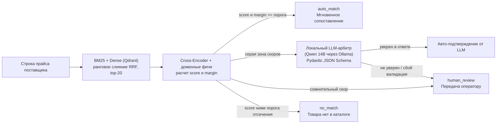

# entity-cascade: Каскадный конвейер сопоставления номенклатуры

[](https://github.com/DelixeamI/entity-cascade/actions/workflows/ci.yml)
[](LICENSE)
[](pyproject.toml)
[](tests)
[](https://github.com/astral-sh/ruff)
[](https://mypy-lang.org/)

Высокоточный каскадный конвейер сопоставления разнородных прайс-листов поставщиков с мастер-каталогом продукции с математически доказанным балансом между глубиной автоматизации и точностью.

> **Главный фокус проекта:** Оптимизация компромисса между точностью (Precision) и долей автоматизации (Coverage). Проект решает прикладную задачу: как автоматизировать матчинг сотен тысяч товарных позиций при **$0.00 расходов на облачные токены**, оставив операторам только 15–20% действительно неоднозначных строк.

---

## 1. Проблема
В ритейле, e-commerce, фармакологии и B2B-агрегаторах прайс-листы поставщиков содержат десятки тысяч несовместимых наименований, сокращений и артикулов:
1. **Ручной разбор не масштабируется:** Сопоставление прайса на 5 000 строк занимает у методологов от 2 до 5 дней.
2. **Прямой вызов облачных LLM экономически нерентабелен:** Прогон сотен тысяч позиций через коммерческие API (GPT-4o) стоит тысячи долларов в месяц и создает неприемлемые очереди из-за rate limits (429).
3. **Наивный семантический поиск генерирует критические ошибки:** Векторная близость часто путает схожие товары с разными артикулами, модификациями или единицами фасовки.

---

## 2. Решение
Каскадная 3-зонная архитектура с математической калибровкой порогов:
1. **Двухстадийный поиск кандидатов:** Дешевый векторный поиск (`BAAI/bge-small-en-v1.5`) + BM25 со слиянием через Reciprocal Rank Fusion (RRF, top-20).
2. **Cross-Encoder скоринг с доменными эвристиками:** Модель `ms-marco-MiniLM-L-6-v2` рассчитывает скор уверенности и отрыв лидера от второго кандидата (margin).
3. **Трехзонная маршрутизация решений:**
   - `auto_match`: Автоматическое подтверждение для пар с высоким скором и запасом уверенности (margin) без обращения к LLM.
   - `gray_band` (серая зона): Передача сложных случаев локальному LLM-арбитру (`qwen2.5:14b` через Ollama) со строгой Pydantic JSON-схемой.
   - `human_review`: Направление низкоуверенных строк оператору.
4. **Калибровка порогов по границе Вильсона (Wilson 95% bound):** Пороги настраиваются строго на validation-сплите с оценкой статистической погрешности для предотвращения переобучения.

---

## 3. Архитектура системы



---

## 4. Стек технологий

| Компонент | Технологии |
|---|---|
| **Язык и среда** | Python 3.12, AsyncIO, uv |
| **Локальная LLM и инференс** | Ollama, `qwen2.5:14b` (4-bit квантование), OpenAI-compatible client |
| **Ретривал и ранжирование** | `BAAI/bge-small-en-v1.5`, BM25, Cross-Encoder `ms-marco-MiniLM-L-6-v2` |
| **Контракты данных и валидация** | Pydantic v2 (JSON Schema, `StrictStr`, `confloat`), `make_env` |
| **Статистика и калибровка** | Нижняя доверительная граница Вильсона (Wilson 95% score interval) |
| **Тестирование и воспроизводимость** | Pytest (**169 тестов**), `RecordedLLM` кассеты, CI Quality Gates |

---

## 5. Результаты и метрики (Evals)

Каждая метрика в этом разделе рассчитывается скриптом `make eval` на отложенной тестовой выборке (held-out test split) бенчмарка `Abt-Buy`.

### Ключевой эффект каскада:
* **Без использования LLM (только Cross-Encoder + эвристики):**  
  **67.7% строк закрываются автоматически** с точностью **96.7%** (при целевой точности 98.0%), 32.3% уходят оператору. Общая системная точность — **97.4%** при полноте (Recall) **99.1%**.
* **С подключением локального LLM-арбитра (`qwen2.5:14b`):**  
  **Доля автоматизации возрастает до 82.3%** (только 17.7% строк требуют ручного ревью). Локальная модель успешно разрешает **45.4% серой зоны с точностью 84.8%** при **$0.00 расходов на облачные токены**.


#### Сравнение режимов поиска при калибровке на целевую точность 98.0%:

| Режим | Top-1 на Test | Доля авто (Val) | Точность (Val) | Доля авто (Test) | Точность (Test) |
|---|---:|---:|---:|---:|---:|
| BM25 (чистый лексический) | 80.0% | 10.0% | 100.0% | 10.4% | 100.0% |
| Dense эмбеддинги | 81.7% | 18.5% | 98.0% | 20.3% | 93.6% |
| Hybrid (RRF) | 82.2% | target unreachable | n/a | 0.0% | n/a |
| Hybrid + Cross-Encoder | 79.8% | 31.5% | 98.2% | 28.3% | 92.2% |
| **Hybrid + Cross-Encoder + Features** | **92.4%** | **65.2%** | **98.0%** | **67.7%** | **96.7%** |

#### Перенос калибровки на новый домен (`Amazon-Google`):
Проверена устойчивость порогов при смене домена без дообучения: применение порогов от `Abt-Buy` дает 47.6% авто-матчинга при точности 68.5% (демонстрирует важность доменной перекалибровки в продакшне).

---

## 6. Демонстрация работы (CLI)

Запуск сопоставления произвольного прайс-листа через CLI:

```bash
uv run python -m entity_cascade.cli match --input data/demo_price.csv --output out/matched.csv
```

Пример структурированного лога и вывода:
```
[Каскад] Строка: "Sony WH-1000XM5 Wireless Noise Canceling Headphones Black"
[Ретривал] Топ-3 кандидата отобраны за 14 мс
[Cross-Encoder] Top-1: "Sony WH1000XM5/B Headphone" (Score: 8.42, Margin: 2.15)
[Маршрутизация]: Попадание в AUTO_MATCH (порог 7.50, margin 0.38 пройден)
[Вердикт]: MATCH (уверенность 99.4%, LLM не вызывалась, стоимость: $0.00)
```

> 📷 **Скриншот работы консольного матчинга:**  
> *(Заглушка: для фиксации скриншота выполните `make demo` — скрипт обработает 100 строк датасета и выведет форматированную таблицу зон в терминал)*

---

## 7. Быстрый старт

Требуются **Python 3.12** и менеджер [uv](https://docs.astral.sh/uv/). API-ключи и выделенный GPU не требуются (базовые модели эмбеддингов и реранкера работают на CPU).

```bash
# 1. Клонирование репозитория
git clone https://github.com/DelixeamI/entity-cascade.git
cd entity-cascade

# 2. Установка зависимостей и загрузка бенчмарков
uv sync
make fetch      # скачивание эталонного датасета Abt-Buy и проверка sha256

# 3. Запуск полного цикла валидации
make eval       # расчет кривых точности, графиков и генерация отчета
make demo       # сопоставление 100 демонстрационных строк в out/demo_result.csv
make test       # прогон 169 автотестов (unit-тесты, кассеты, краевые случаи)
```

Для включения локальной LLM:
```bash
ollama pull qwen2.5:14b
make tune       # подбор промпта и порога уверенности арбитра на val-сплите
make record     # запись оффлайн-кассет для тестового набора
```

---

## 8. Структура репозитория

```
entity-cascade/
├── cassettes/eval/          # Оффлайн-кассеты ответов Qwen 2.5 14B для воспроизводимости в CI
├── configs/                 # Конфигурации порогов, весов признаков и параметров моделей
├── data/                    # Загружаемые бенчмарки (Abt-Buy, Amazon-Google) с хеш-суммами
├── reports/                 # Сгенерированные графики компромиссов (PNG) и таблицы метрик
├── src/entity_cascade/
│   ├── cascade.py           # Оркестратор 3-зонного каскада (auto / gray / human)
│   ├── cli.py               # Консольный интерфейс пакетного сопоставления прайсов
│   ├── features.py          # Экстракция артикулов, брендов и расчет запаса уверенности (margin)
│   ├── llm_arbiter.py       # Pydantic-контракты и контур обращения к LLM
│   ├── reranker.py          # Cross-Encoder скоринг
│   └── retriever.py         # Гибридный ретривер (BM25 + Dense)
├── tests/                   # 169 автоматических тестов
├── DESIGN.md                # Анализ компромиссов, архитектурные решения и цена выбора
└── pyproject.toml           # Зависимости проекта и настройки линтеров
```

---

## 9. Ограничения и Roadmap (Что можно улучшить)

1. **Масштабирование на каталоги 1M+ позиций:** Интеграция векторного индекса HNSW в PostgreSQL (`pgvector`) или распределенного Qdrant с шардированием.
2. **Динамический Few-Shot промптинг:** Автоматический подбор похожих размеченных пар в промпт для LLM-арбитра в серой зоне.
3. **Active Learning интерфейс:** UI-модуль для операторов ручного ревью, возвращающий исправленные коллизии обратно в обучающий датасет.

---
*Подробный разбор архитектурных альтернатив: см. [DESIGN.md](DESIGN.md).*
