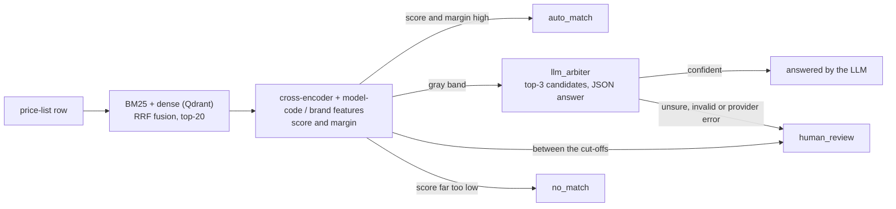

# entity-cascade

[](https://github.com/DelixeamI/entity-cascade/actions/workflows/ci.yml)
[](LICENSE)
[](pyproject.toml)
[](tests)

Match supplier price-list rows to a product catalog with a cascade: cheap retrieval, a cross-encoder reranker, an LLM for the doubtful rows, a human for the unsure ones.
The point of the project is the trade-off every such system has to make: how much work you automate versus how accurate the automatic answers are, measured on a held-out split.



## Results

Every number and chart in this section is written by `make eval` (from `reports/results.json`). The full tables are in [reports/results.md](reports/results.md).

<!-- results:start -->
_Generated by `make eval` from `reports/results.json`. Do not edit between the markers._

Dataset `abt_buy`, seed 13. Thresholds are fitted on the val split, every number below is on the held-out test split unless it says otherwise.

- Accepting every top-1 answer: precision 78.6% with zero human work.
- Cascade without the LLM: 67.7% of rows answered automatically, auto_match precision 96.7% (target 98.0%), 32.3% of rows left to a human; system precision 97.4%, recall 99.1% when the human is right.
- With the LLM arbiter (`qwen2.5:14b`): 82.3% automated, 17.7% to a human; it resolves 45.4% of the gray zone at 84.8% accuracy; system precision 96.3%, recall 97.2%; $0.0000 per 1000 rows.


#### Mode comparison at equal footing

Each mode is trusted by its own score and margin. Thresholds are fitted on val so that the auto zone reaches 98.0% precision there, then applied to test. Share = fraction of all rows answered automatically.

| mode | top-1 (test) | val: auto share | val: precision | test: auto share | test: precision |
|---|---:|---:|---:|---:|---:|
| bm25 | 80.0% | 10.0% | 100.0% | 10.4% | 100.0% |
| dense | 81.7% | 18.5% | 98.0% | 20.3% | 93.6% |
| hybrid (RRF) | 82.2% | target unreachable on val | n/a | 0.0% | n/a |
| hybrid + reranker | 79.8% | 31.5% | 98.2% | 28.3% | 92.2% |
| hybrid + reranker + features | 92.4% | 65.2% | 98.0% | 67.7% | 96.7% |

#### The trade-off: target precision vs automation

Thresholds refitted on val for each target; the cascade without the LLM, so every non-auto row goes to a human. Val is where thresholds were fitted; test is held out.

| target precision | val: auto share | val: precision | test: auto share | test: precision | test: human share | test: system precision | test: system recall |
|---|---:|---:|---:|---:|---:|---:|---:|
| 90.0% | 81.5% | 90.0% | 83.0% | 90.2% | 17.0% | 90.9% | 95.7% |
| 95.0% | 71.5% | 95.1% | 73.2% | 96.2% | 26.8% | 96.8% | 98.5% |
| 98.0% | 65.2% | 98.0% | 67.7% | 96.7% | 32.3% | 97.4% | 99.1% |
| 99.0% | 56.1% | 99.0% | 56.7% | 98.4% | 43.3% | 98.9% | 99.6% |
| 99.5% | 49.4% | 99.6% | 54.0% | 99.7% | 46.0% | 99.8% | 100.0% |
| 98.0% (Wilson 95% bound) | unreachable on val | | | | | | |

#### Second dataset: amazon_google

Same code, same models; only the config differs. The first row applies the thresholds (and feature weights) fitted on the first dataset's val split without any change; the second row fits them on this dataset's own val split. Metrics are on this dataset's test split, cascade without the LLM.

| calibration | high | margin | auto share | auto precision | human share | system precision | system recall |
|---|---:|---:|---:|---:|---:|---:|---:|
| abt_buy calibration, not refitted | 7.50 | 0.38 | 47.6% | 68.5% | 52.4% | 83.3% | 91.9% |
| refitted on amazon_google val | unreachable | 0.00 | 0.0% | n/a | 100.0% | 100.0% | 100.0% |

Full tables: [reports/results.md](reports/results.md).
<!-- results:end -->

## Run it in a minute

Needs Python 3.12 and [uv](https://docs.astral.sh/uv/). No API keys, no GPU: the embedding model (`BAAI/bge-small-en-v1.5`) and the reranker (`cross-encoder/ms-marco-MiniLM-L-6-v2`) are small and run on CPU; they are downloaded from the Hugging Face Hub on first use.

```bash
uv sync
make fetch      # downloads Abt-Buy and checks its sha256
make eval       # reports/results.md, reports/*.png, the numbers block above
make demo       # 100 rows through the CLI -> out/demo_result.csv
make test       # unit tests + the CI gate on the fixture slice
make tune       # needs Ollama: pick the LLM prompt and threshold on val
make record     # needs Ollama: record the test-split answers
```

On Windows without `make`, run the underlying commands from the `Makefile` with `uv run ...`.

Match your own price list (columns `id`, `name`, optionally `description`):

```bash
uv run python -m entity_cascade.cli match --input price.csv --output result.csv
```

The output has the zone, the verdict (`match`, `no_match`, `needs_human`), who decided, the matched catalog item, the score, the margin and a plain-text reason per row; a summary is printed at the end. The CLI needs `reports/calibration.json`, which `make eval` writes.

## The LLM, and what is and is not recorded

The arbiter talks to a `LLMClient` interface with three implementations:

- `FakeLLM` / `HeuristicFakeLLM`: test doubles. They are not models, and nothing quotes their accuracy as LLM quality.
- `RecordedLLM`: replays cassettes (`tests/cassettes/`, `cassettes/eval/`), keyed by sha256 of model + prompt. A missing cassette is an error, never an invented answer. This is what keeps `make test` and `make eval` free of API keys.
- `OpenAICompatibleLLM`: any OpenAI-style `/chat/completions` endpoint (Ollama, vLLM, a cloud API) via `llm.base_url`, `llm.model` and the key in `$LLM_API_KEY`. Concurrency is capped by a semaphore, 429 and 5xx are retried with exponential backoff and jitter, every request has a timeout.

`make tune` records the arbiter on the val gray zone for every prompt version and picks the version and `llm.min_confidence` by the rule in the config (val only). `make record` then runs the chosen prompt on the test split and writes the cassettes. Changing the prompt, the model or the thresholds (they decide which rows reach the arbiter) means re-recording.

## Data

Abt-Buy and Amazon-Google come from the Leipzig entity-resolution benchmark collection (<https://dbs.uni-leipzig.de/research/projects/benchmark-datasets-for-entity-resolution>). `make fetch` downloads them and verifies the sha256 pinned in `data/checksums.json` (pinned on the first download, trust on first use). The repository itself contains only a 50-row slice in `tests/fixtures/` and LLM prompts and answers for gray-zone rows in `cassettes/`, which quote product text from the dataset. Check the benchmark's terms of use before redistributing them or making the repository public.

## Limitations

- The fixture cassettes in `tests/cassettes/` come from a heuristic test double. The CI gate therefore guards the pipeline against regressions; it says nothing about LLM quality. The real recording (`cassettes/eval/`, `qwen2.5:14b` via Ollama) covers the Abt-Buy val and test gray zones only; the prompt version and `min_confidence` were chosen on val (`make tune`), and the val-to-test drop in the arbiter's accuracy is reported.
- Abt-Buy is small and its catalog contains exactly the products that have pairs. Retrieval recall on a real catalog with hundreds of thousands of items will be lower; measure that first.
- Every Abt row has a true pair, so the `no_match` zone cannot be evaluated on the raw data. The default config removes the true items of a random share of rows from the catalog ("synthetic new products"); this is labeled wherever it affects a number.
- Thresholds are fitted on half of a small dataset. The gap between val and test precision of the auto zone is reported rather than hidden; see the trade-off table.
- Thresholds are domain-specific: the second dataset section shows what happens without recalibration.
- The arbiter settings were fitted on 188 val gray-zone rows with one model. A different model needs its own `make tune`; the self-reported confidence is only a coarse filter and its meaning depends on the prompt.
- Latency numbers are single-process CPU timings from the machine that ran `make eval`.

More detail: [DESIGN.md](DESIGN.md) (decisions and their price), [QUESTIONS.md](QUESTIONS.md) (interview questions), [PLAN.md](PLAN.md), [PROGRESS.md](PROGRESS.md).
