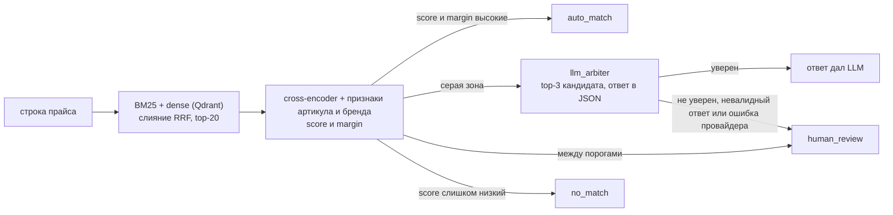

# entity-cascade: каскадный конвейер сопоставления номенклатуры

[](https://github.com/DelixeamI/entity-cascade/actions/workflows/ci.yml)
[](LICENSE)
[](pyproject.toml)
[](tests)
[](https://github.com/astral-sh/ruff)
[](https://mypy-lang.org/)

Каскадное сопоставление строк прайс-листа поставщика с каталогом товаров: дешёвый поиск, reranker (cross-encoder), LLM для спорных строк и человек для неуверенных. Для каждой строки каскад возвращает найденный товар или ответ «пары нет» и говорит, насколько он в этом уверен.

> **Главный фокус проекта:** компромисс между долей автоматизации и точностью автоматических ответов, измеренный на отложенной (test) выборке. Пороги подбираются только на val. LLM работает локально (Ollama), облачные токены не тратятся.

---

## 1. Проблема

Прайс-листы поставщиков содержат наименования, сокращения и артикулы, которые не совпадают с названиями в каталоге покупателя:

1. **Ручной разбор не масштабируется.** Каждую строку должен сопоставить человек.
2. **LLM на каждую строку дорога и медленна.** Каталог не помещается в контекст, поэтому поиск кандидатов нужен всё равно, а цена и задержка растут с числом строк.
3. **Наивный семантический поиск ошибается на похожих товарах.** Векторная близость легко путает варианты с разными артикулами, цветами или комплектацией.

---

## 2. Решение

Каскад, в котором каждый следующий уровень получает только то, что не решил предыдущий, и каждый уровень сам оценивает свою уверенность:

1. **Поиск кандидатов.** BM25 и dense-поиск (`BAAI/bge-small-en-v1.5` в Qdrant), слияние через Reciprocal Rank Fusion, top-20.
2. **Cross-encoder с признаками.** `ms-marco-MiniLM-L-6-v2` даёт score; к нему добавляются признаки совпадения артикула и бренда (веса подобраны на val). Отдельно считается margin: разность score первого и второго кандидата.
3. **Четыре зоны:**
   - `auto_match`: высокий score и достаточный margin, ответ без LLM;
   - `llm_arbiter`: спорные строки уходят локальному LLM-арбитру (`qwen2.5:14b` через Ollama), который выбирает один из трёх кандидатов или отвечает «none» в виде JSON, проверяемого Pydantic;
   - `human_review`: строки, которые не стоит показывать даже арбитру;
   - `no_match`: score настолько низкий, что пары, скорее всего, нет.
4. **Пороги подбираются на val, метрики считаются на test.** Тесты проверяют, что метки test не влияют на подбор. Оценка неопределённости порогов (нижняя граница Уилсона) доступна параметром `thresholds.wilson_z`; по умолчанию она выключена, а в таблице компромисса показана для сравнения.

---

## 3. Архитектура системы



Решения и их цена (почему RRF, зачем margin, как подбирались пороги, что делать с новыми товарами): [DESIGN.md](DESIGN.md).

---

## 4. Стек технологий

| Компонент | Технологии |
|---|---|
| **Язык и среда** | Python 3.12, asyncio, uv |
| **Поиск и ранжирование** | `BAAI/bge-small-en-v1.5`, `rank_bm25`, Qdrant (в тестах и eval `:memory:`), cross-encoder `ms-marco-MiniLM-L-6-v2` |
| **LLM** | интерфейс `LLMClient`: тестовые двойники, `RecordedLLM` (кассеты), `OpenAICompatibleLLM` (`httpx`; проверено с Ollama, `qwen2.5:14b`) |
| **Контракты данных** | Pydantic v2: конфиг, схема ответа арбитра, результаты отчёта |
| **Отчёты** | matplotlib, Markdown и JSON из `make eval` |
| **Качество и воспроизводимость** | pytest (169 тестов), ruff, mypy `--strict`, GitHub Actions, кассеты `RecordedLLM`, CI-гейт на срезе фикстур |

---

## 5. Результаты и метрики (Evals)

Каждое число и каждый график в этом разделе записывает `make eval` (из `reports/results.json`) на отложенной test-выборке бенчмарка Abt-Buy, если не сказано иное. Полные таблицы: [reports/results.md](reports/results.md). Сгенерированный блок ниже остаётся на английском: его текст формирует код отчёта.

<!-- results:start -->
_Generated by `make eval` from `reports/results.json`. Do not edit between the markers._

Dataset `abt_buy`, seed 13. Thresholds are fitted on the val split, every number below is on the held-out test split unless it says otherwise.

- Accepting every top-1 answer: precision 78.6% with zero human work.
- Cascade without the LLM: 67.7% of rows answered automatically, auto_match precision 96.7% (target 98.0%), 32.3% of rows left to a human; system precision 97.4%, recall 99.1% when the human is right.
- With the LLM arbiter (`qwen2.5:14b`): 82.3% automated, 17.7% to a human; it resolves 45.4% of the gray zone at 84.8% accuracy; system precision 96.3%, recall 97.2%; $0.0000 per 1000 rows.


#### Mode comparison at equal footing

Each mode is trusted by its own score and margin. Thresholds are fitted on val so that the auto zone reaches 98.0% precision there, then applied to test. Share = fraction of all rows answered automatically.

| mode | top-1 (test) | val: auto share | val: precision | test: auto share | test: precision |
|---|---:|---:|---:|---:|---:|
| bm25 | 80.0% | 10.0% | 100.0% | 10.4% | 100.0% |
| dense | 81.7% | 18.5% | 98.0% | 20.3% | 93.6% |
| hybrid (RRF) | 82.2% | target unreachable on val | n/a | 0.0% | n/a |
| hybrid + reranker | 79.8% | 31.5% | 98.2% | 28.3% | 92.2% |
| hybrid + reranker + features | 92.4% | 65.2% | 98.0% | 67.7% | 96.7% |

#### The trade-off: target precision vs automation

Thresholds refitted on val for each target; the cascade without the LLM, so every non-auto row goes to a human. Val is where thresholds were fitted; test is held out.

| target precision | val: auto share | val: precision | test: auto share | test: precision | test: human share | test: system precision | test: system recall |
|---|---:|---:|---:|---:|---:|---:|---:|
| 90.0% | 81.5% | 90.0% | 83.0% | 90.2% | 17.0% | 90.9% | 95.7% |
| 95.0% | 71.5% | 95.1% | 73.2% | 96.2% | 26.8% | 96.8% | 98.5% |
| 98.0% | 65.2% | 98.0% | 67.7% | 96.7% | 32.3% | 97.4% | 99.1% |
| 99.0% | 56.1% | 99.0% | 56.7% | 98.4% | 43.3% | 98.9% | 99.6% |
| 99.5% | 49.4% | 99.6% | 54.0% | 99.7% | 46.0% | 99.8% | 100.0% |
| 98.0% (Wilson 95% bound) | unreachable on val | | | | | | |

#### Second dataset: amazon_google

Same code, same models; only the config differs. The first row applies the thresholds (and feature weights) fitted on the first dataset's val split without any change; the second row fits them on this dataset's own val split. Metrics are on this dataset's test split, cascade without the LLM.

| calibration | high | margin | auto share | auto precision | human share | system precision | system recall |
|---|---:|---:|---:|---:|---:|---:|---:|
| abt_buy calibration, not refitted | 7.50 | 0.38 | 47.6% | 68.5% | 52.4% | 83.3% | 91.9% |
| refitted on amazon_google val | unreachable | 0.00 | 0.0% | n/a | 100.0% | 100.0% | 100.0% |

Full tables: [reports/results.md](reports/results.md).
<!-- results:end -->

---

## 6. Демонстрация работы (CLI)

Сопоставление произвольного прайс-листа (колонки `id`, `name`, при желании `description`):

```bash
uv run python -m entity_cascade.cli match --input price.csv --output result.csv
```

`make demo` прогоняет первые 100 строк test-выборки Abt-Buy. Пример реального вывода (числа зависят от версии кассет и порогов):

```
demo: first 100 rows of the abt_buy test split
rows: 100   time: 54.6 s (546 ms per row)
zones:     auto_match=  60 ( 60.0%)   llm_arbiter=  40 ( 40.0%)   human_review=   0 (  0.0%)   no_match=   0 (  0.0%)
verdicts:  match=  75 ( 75.0%)   no_match=   2 (  2.0%)   needs_human=  23 ( 23.0%)
handled:   auto=  60 ( 60.0%)   llm=  17 ( 17.0%)   human=  23 ( 23.0%)
llm tokens: 20183 in / 1144 out, cost $0.0000 (prices from the config)
against ground truth (a human is assumed right): automated 77.0%, auto match precision 96.0%, system precision 96.6%, recall 96.6%
```

Для каждой строки в `out/demo_result.csv` записаны зона, вердикт, кто решил, найденный товар, score, margin и причина:

```
id,name,zone,verdict,handled_by,matched_id,matched_name,score,margin,reason
4696,Sony Switcher - SBV40S,auto_match,match,auto,90049928,Sony SB-V40S A/V Selector - SBV40S,11.705,16.518,"auto_match: score 11.71, margin 16.52 (needs >= 7.50 and >= 0.38); model code equal, brand equal"
6284,Bose 27028 161 Bookshelf Pair Speakers In White - 161WH,llm_arbiter,match,llm,202812567,Boss 161 Speaker,2.016,11.034,llm_arbiter (confidence 0.90): Model number matches base model 161
```

---

## 7. Быстрый старт

Нужны **Python 3.12** и [uv](https://docs.astral.sh/uv/). API-ключи и GPU не нужны: модель эмбеддингов и reranker небольшие и работают на CPU; при первом запуске они скачиваются с Hugging Face Hub.

```bash
git clone https://github.com/DelixeamI/entity-cascade.git
cd entity-cascade

uv sync
make fetch      # скачивает Abt-Buy и проверяет sha256
make eval       # reports/results.md, reports/*.png, блок с числами выше
make demo       # 100 строк через CLI -> out/demo_result.csv
make test       # юнит-тесты + CI-гейт на срезе фикстур
```

В Windows без `make` выполняйте команды из `Makefile` через `uv run ...`. CLI требует `reports/calibration.json`, который создаёт `make eval`.

### LLM-арбитр

Арбитр работает через интерфейс `LLMClient`:

- `FakeLLM` / `HeuristicFakeLLM`: тестовые двойники, не модели. Их точность нигде не выдаётся за качество LLM.
- `RecordedLLM`: воспроизводит кассеты (`tests/cassettes/`, `cassettes/eval/`) по sha256 от модели и промпта. Отсутствующая кассета даёт ошибку, а не выдуманный ответ. Благодаря этому `make test` и `make eval` работают без ключей и без Ollama.
- `OpenAICompatibleLLM`: любой OpenAI-совместимый endpoint `/chat/completions` (Ollama, vLLM, облачный API). Параметры берутся из `configs/default.yaml` (`llm.base_url`, `llm.model`, таймауты, лимит параллелизма), ключ из переменной окружения `LLM_API_KEY` (см. `.env.example`). Параллелизм ограничен семафором, на 429 и 5xx выполняются повторы с экспоненциальным backoff и jitter.

Чтобы записать собственные кассеты с локальной моделью:

```bash
ollama pull qwen2.5:14b
make tune       # val: промпт и llm.min_confidence выбираются по правилу из конфига
make record     # test: запись ответов выбранного промпта
make eval       # пересчёт отчёта по кассетам
```

Смена промпта, модели или порогов (они определяют, какие строки попадают к арбитру) требует перезаписи кассет.

---

## 8. Структура репозитория

```
entity-cascade/
├── cassettes/eval/          # кассеты ответов qwen2.5:14b (val и test, Abt-Buy)
├── configs/                 # default.yaml, amazon_google.yaml, fixture.yaml
├── data/checksums.json      # sha256 бенчмарков (сами данные скачивает make fetch)
├── reports/                 # результаты make eval: results.md/json, графики, calibration.json
├── scripts/                 # fetch_data.py, make_fixtures.py, ce_input_experiment.py
├── src/entity_cascade/
│   ├── data/                # загрузка, нормализация, сплит val/test, статистика
│   ├── retrieval/           # BM25, dense (Qdrant), RRF, генератор кандидатов
│   ├── rerank/              # cross-encoder, признаки артикула и бренда, подбор весов
│   ├── zones/               # пороги и распределение по зонам
│   ├── llm/                 # LLMClient, кассеты, OpenAI-совместимый клиент, арбитр
│   ├── eval/                # метрики, отчёт, графики, тюнинг арбитра, CI-гейт
│   ├── calibration.py       # всё, что подбирается по меткам (только val)
│   ├── matcher.py           # весь каскад на произвольных строках
│   ├── pipeline.py          # поиск + reranker с замером времени
│   └── cli.py               # команда match
├── tests/                   # 169 тестов, фикстуры и кассеты для CI
├── DESIGN.md                # решения, отвергнутые альтернативы, цена
├── QUESTIONS.md             # вопросы с собеседований и ответы
├── eval_thresholds.yaml     # пороги CI-гейта на фикстурах
└── pyproject.toml           # зависимости и настройки ruff, mypy, pytest
```

---

## 9. Ограничения и Roadmap

### Ограничения

- Кассеты фикстур в `tests/cassettes/` записаны эвристическим тестовым двойником, поэтому CI-гейт защищает пайплайн от регрессий, но ничего не говорит о качестве LLM. Реальная запись (`cassettes/eval/`, `qwen2.5:14b`) покрывает только серые зоны val и test на Abt-Buy.
- Abt-Buy мал, а его каталог состоит ровно из товаров, у которых есть пары. На каталоге в сотни тысяч позиций recall поиска будет ниже; мерить нужно в первую очередь его.
- У каждой строки Abt есть пара, поэтому `no_match` на сырых данных не оценить. По умолчанию из каталога удаляются истинные товары 15% строк («синтетические новые товары»); это помечено везде, где влияет на число.
- Пороги подобраны на половине небольшого датасета. Разрыв precision auto-зоны между val и test показан в отчёте, а не скрыт.
- Пороги привязаны к домену: на Amazon-Google без перекалибровки они не работают (см. раздел про второй датасет в блоке результатов).
- Настройки арбитра подобраны на 188 строках серой зоны val и для одной модели. Для другой модели нужен свой `make tune`.
- Латентность это замеры одного процесса на CPU той машины, где выполнялся `make eval`.

### Roadmap

1. Каталоги в сотни тысяч позиций: ANN-индекс на Qdrant с шардированием и повторное измерение recall поиска.
2. Few-shot промпт арбитра: подбор похожих размеченных пар в промпт, проверка на val.
3. Дообучение cross-encoder на товарных парах и сравнение с текущим вариантом признаков.
4. Интерфейс для операторов `human_review`: подтверждённые решения как разметка для перекалибровки порогов.

---

## Данные и лицензия

Abt-Buy и Amazon-Google взяты из коллекции бенчмарков Лейпцигского университета по entity resolution (<https://dbs.uni-leipzig.de/research/projects/benchmark-datasets-for-entity-resolution>). `make fetch` скачивает их и проверяет sha256 из `data/checksums.json` (хеш фиксируется при первом скачивании, доверие при первом использовании). В репозитории лежат только срез из 50 строк в `tests/fixtures/` и промпты с ответами LLM для строк серой зоны в `cassettes/`, в которых цитируется текст товаров из датасета. Код распространяется по лицензии [MIT](LICENSE).

---
*Подробный разбор решений: [DESIGN.md](DESIGN.md). Вопросы с собеседований: [QUESTIONS.md](QUESTIONS.md). План и журнал работ: [PLAN.md](PLAN.md), [PROGRESS.md](PROGRESS.md).*
