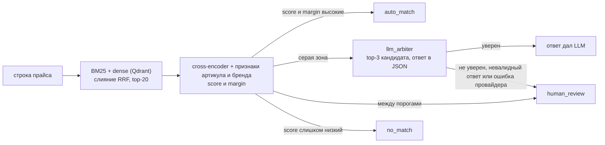
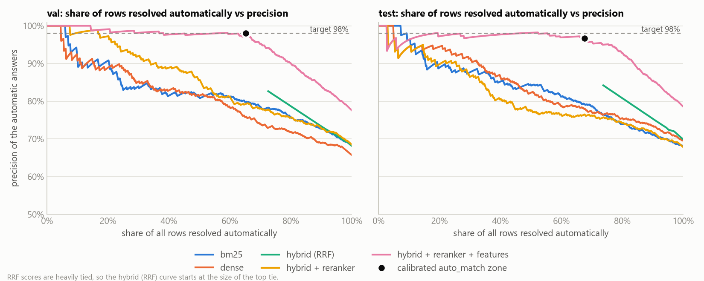
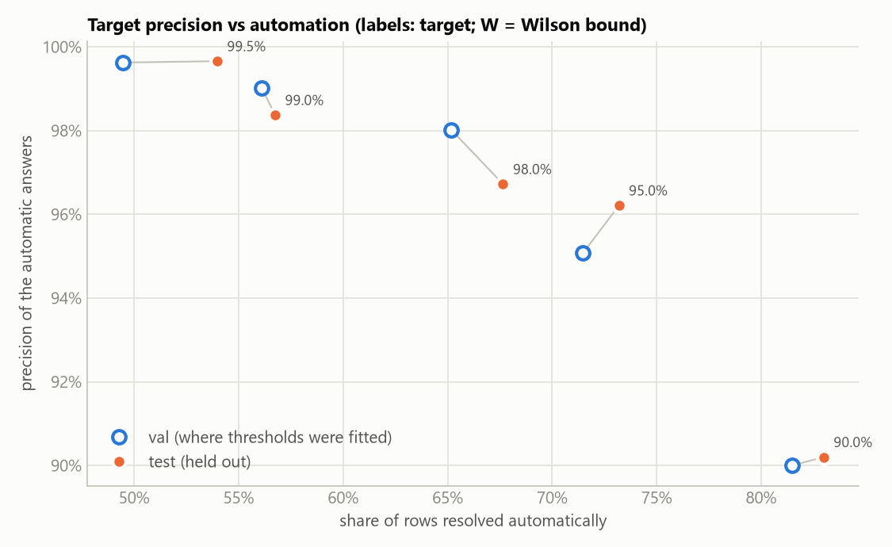
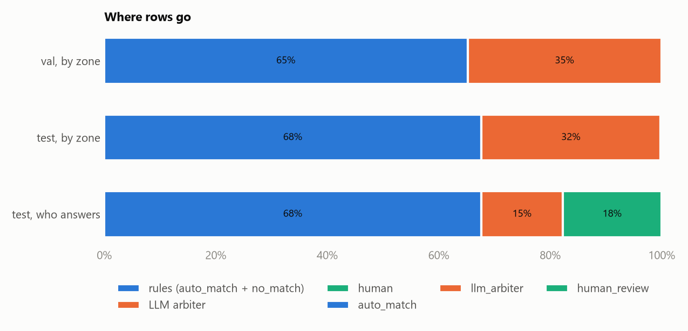

# entity-cascade

[](https://github.com/DelixeamI/entity-cascade/actions/workflows/ci.yml)
[](LICENSE)
[](pyproject.toml)
[](tests)

Сопоставление строк прайса поставщика с каталогом товаров каскадом: дешёвый поиск, reranker (cross-encoder), LLM для спорных строк и человек для неуверенных.
Главная тема проекта: компромисс, который неизбежен в такой системе, между долей автоматизации и точностью автоматических ответов. Он измеряется на отложенной (test) выборке.



## Результаты

Каждое число и каждый график в этом разделе записывает `make eval` (из `reports/results.json`). Полные таблицы: [reports/results.md](reports/results.md). Сгенерированный блок ниже остаётся на английском: его текст формирует код отчёта.

<!-- results:start -->
_Generated by `make eval` from `reports/results.json`. Do not edit between the markers._

Dataset `abt_buy`, seed 13. Thresholds are fitted on the val split, every number below is on the held-out test split unless it says otherwise.

- Accepting every top-1 answer: precision 78.6% with zero human work.
- Cascade without the LLM: 67.7% of rows answered automatically, auto_match precision 96.7% (target 98.0%), 32.3% of rows left to a human; system precision 97.4%, recall 99.1% when the human is right.
- With the LLM arbiter (`qwen2.5:14b`): 82.3% automated, 17.7% to a human; it resolves 45.4% of the gray zone at 84.8% accuracy; system precision 96.3%, recall 97.2%; $0.0000 per 1000 rows.







#### Mode comparison at equal footing

Each mode is trusted by its own score and margin. Thresholds are fitted on val so that the auto zone reaches 98.0% precision there, then applied to test. Share = fraction of all rows answered automatically.

| mode | top-1 (test) | val: auto share | val: precision | test: auto share | test: precision |
|---|---:|---:|---:|---:|---:|
| bm25 | 80.0% | 10.0% | 100.0% | 10.4% | 100.0% |
| dense | 81.7% | 18.5% | 98.0% | 20.3% | 93.6% |
| hybrid (RRF) | 82.2% | target unreachable on val | n/a | 0.0% | n/a |
| hybrid + reranker | 79.8% | 31.5% | 98.2% | 28.3% | 92.2% |
| hybrid + reranker + features | 92.4% | 65.2% | 98.0% | 67.7% | 96.7% |

#### The trade-off: target precision vs automation

Thresholds refitted on val for each target; the cascade without the LLM, so every non-auto row goes to a human. Val is where thresholds were fitted; test is held out.

| target precision | val: auto share | val: precision | test: auto share | test: precision | test: human share | test: system precision | test: system recall |
|---|---:|---:|---:|---:|---:|---:|---:|
| 90.0% | 81.5% | 90.0% | 83.0% | 90.2% | 17.0% | 90.9% | 95.7% |
| 95.0% | 71.5% | 95.1% | 73.2% | 96.2% | 26.8% | 96.8% | 98.5% |
| 98.0% | 65.2% | 98.0% | 67.7% | 96.7% | 32.3% | 97.4% | 99.1% |
| 99.0% | 56.1% | 99.0% | 56.7% | 98.4% | 43.3% | 98.9% | 99.6% |
| 99.5% | 49.4% | 99.6% | 54.0% | 99.7% | 46.0% | 99.8% | 100.0% |
| 98.0% (Wilson 95% bound) | unreachable on val | | | | | | |

#### Second dataset: amazon_google

Same code, same models; only the config differs. The first row applies the thresholds (and feature weights) fitted on the first dataset's val split without any change; the second row fits them on this dataset's own val split. Metrics are on this dataset's test split, cascade without the LLM.

| calibration | high | margin | auto share | auto precision | human share | system precision | system recall |
|---|---:|---:|---:|---:|---:|---:|---:|
| abt_buy calibration, not refitted | 7.50 | 0.38 | 47.6% | 68.5% | 52.4% | 83.3% | 91.9% |
| refitted on amazon_google val | unreachable | 0.00 | 0.0% | n/a | 100.0% | 100.0% | 100.0% |

Full tables: [reports/results.md](reports/results.md).
<!-- results:end -->

## Запуск за минуту

Нужны Python 3.12 и [uv](https://docs.astral.sh/uv/). API-ключи и GPU не нужны: модель эмбеддингов (`BAAI/bge-small-en-v1.5`) и reranker (`cross-encoder/ms-marco-MiniLM-L-6-v2`) небольшие и работают на CPU; при первом запуске они скачиваются с Hugging Face Hub.

```bash
uv sync
make fetch      # скачивает Abt-Buy и проверяет sha256
make eval       # reports/results.md, reports/*.png, блок с числами выше
make demo       # 100 строк через CLI -> out/demo_result.csv
make test       # юнит-тесты + CI-гейт на срезе фикстур
make tune       # нужна Ollama: подбор промпта и порога LLM на val
make record     # нужна Ollama: запись ответов на test-выборке
```

В Windows без `make` выполняйте команды из `Makefile` через `uv run ...`.

Сопоставить собственный прайс (колонки `id`, `name`, при желании `description`):

```bash
uv run python -m entity_cascade.cli match --input price.csv --output result.csv
```

В результате для каждой строки записаны зона, вердикт (`match`, `no_match`, `needs_human`), кто принял решение, найденный товар каталога, score, margin и текстовая причина; в конце печатается сводка. CLI требует `reports/calibration.json`, который создаёт `make eval`.

## LLM: что записано, а что нет

Арбитр работает через интерфейс `LLMClient` с тремя реализациями:

- `FakeLLM` / `HeuristicFakeLLM`: тестовые двойники. Это не модели, и их точность нигде не выдаётся за качество LLM.
- `RecordedLLM`: воспроизводит кассеты (`tests/cassettes/`, `cassettes/eval/`) по ключу sha256 от модели и промпта. Отсутствующая кассета даёт ошибку, а не выдуманный ответ. Благодаря этому `make test` и `make eval` работают без API-ключей.
- `OpenAICompatibleLLM`: любой OpenAI-совместимый endpoint `/chat/completions` (Ollama, vLLM, облачный API) через `llm.base_url`, `llm.model` и ключ в `$LLM_API_KEY`. Параллелизм ограничен семафором, на 429 и 5xx выполняются повторы с экспоненциальным backoff и jitter, у каждого запроса есть таймаут.

`make tune` записывает ответы арбитра на серой зоне val для каждой версии промпта и выбирает версию и `llm.min_confidence` по правилу из конфига (только по val). Затем `make record` прогоняет выбранный промпт на test и пишет кассеты. Смена промпта, модели или порогов (они определяют, какие строки попадают к арбитру) требует перезаписи кассет.

## Данные

Abt-Buy и Amazon-Google взяты из коллекции бенчмарков Лейпцигского университета по entity resolution (<https://dbs.uni-leipzig.de/research/projects/benchmark-datasets-for-entity-resolution>). `make fetch` скачивает их и проверяет sha256 из `data/checksums.json` (хеш фиксируется при первом скачивании, доверие при первом использовании). В самом репозитории лежат только срез из 50 строк в `tests/fixtures/` и промпты с ответами LLM для строк серой зоны в `cassettes/`: в них цитируется текст товаров из датасета. Перед распространением проверьте условия использования бенчмарка.

## Ограничения

- Кассеты фикстур в `tests/cassettes/` записаны эвристическим тестовым двойником. Поэтому CI-гейт защищает пайплайн от регрессий, но ничего не говорит о качестве LLM. Реальная запись (`cassettes/eval/`, `qwen2.5:14b` через Ollama) покрывает только серые зоны val и test на Abt-Buy; версия промпта и `min_confidence` выбраны на val (`make tune`), падение точности арбитра с val на test показано в отчёте.
- Abt-Buy мал, а его каталог состоит ровно из товаров, у которых есть пары. На реальном каталоге в сотни тысяч позиций recall поиска будет ниже; мерить нужно в первую очередь его.
- У каждой строки Abt есть истинная пара, поэтому зону `no_match` на сырых данных оценить нельзя. Конфиг по умолчанию удаляет из каталога истинные товары случайной доли строк («синтетические новые товары»); везде, где это влияет на число, это помечено.
- Пороги подобраны на половине небольшого датасета. Разрыв между precision auto-зоны на val и на test показан, а не скрыт; см. таблицу компромисса.
- Пороги привязаны к домену: раздел про второй датасет показывает, что происходит без перекалибровки.
- Настройки арбитра подобраны на 188 строках серой зоны val и для одной модели. Для другой модели нужен свой `make tune`; самоотчётный confidence служит лишь грубым фильтром, и его смысл зависит от промпта.
- Латентность это замеры одного процесса на CPU той машины, где выполнялся `make eval`.

Подробнее: [DESIGN.md](DESIGN.md) (решения и их цена), [QUESTIONS.md](QUESTIONS.md) (вопросы с собеседований), [PLAN.md](PLAN.md), [PROGRESS.md](PROGRESS.md).
