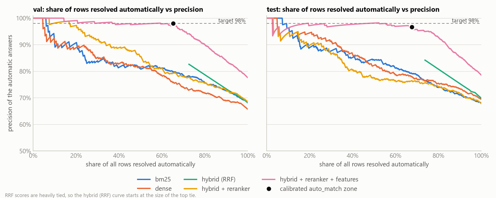
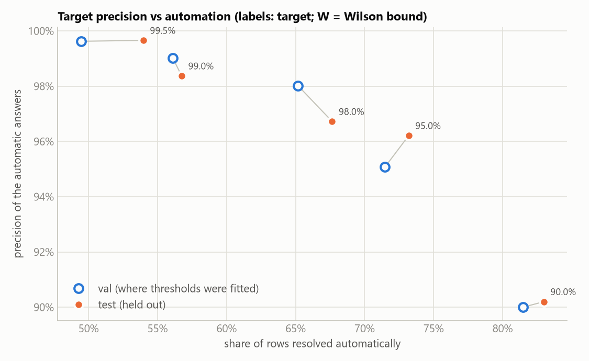
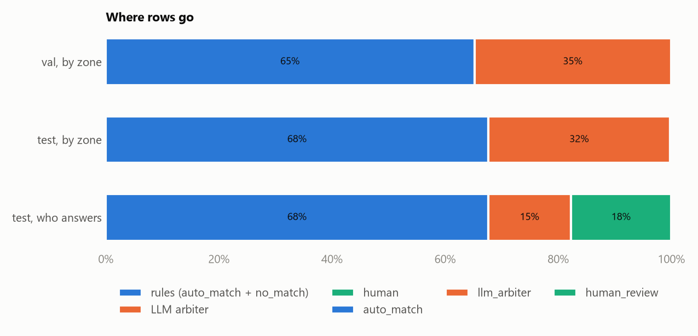

# Results

Generated by `make eval`. Do not edit by hand.

- config: `configs/default.yaml`, seed 13
- embedding model: `BAAI/bge-small-en-v1.5`; reranker: `cross-encoder/ms-marco-MiniLM-L-6-v2`

## Dataset: abt_buy

- price-list rows: 1081; catalog items in the raw data: 1092; true pairs: 1097
- rows with a pair / without: 1081 / 0; rows with several true items: 16
- true pairs sharing a model code: 773 of 1097
- **synthetic** new products: 15.0% of each split (their true items are removed from the catalog, which then has 928 items)

| split | rows | with pair | synthetic new products |
|---|---:|---:|---:|
| val | 540 | 459 | 81 |
| test | 541 | 460 | 81 |

## Candidate recall

Share of rows with a true pair whose true item is in the top-k of the mode.

| mode | split | rows | recall@1 | recall@5 | recall@20 |
|---|---|---:|---:|---:|---:|
| bm25 | val | 459 | 80.4% | 95.0% | 99.3% |
| dense | val | 459 | 77.3% | 95.2% | 99.6% |
| hybrid | val | 459 | 80.2% | 95.6% | 99.8% |
| bm25 | test | 460 | 80.0% | 96.3% | 99.6% |
| dense | test | 460 | 81.7% | 97.4% | 99.8% |
| hybrid | test | 460 | 82.2% | 97.4% | 100.0% |

## Mode comparison at equal footing

Each mode is trusted by its own score and margin. Thresholds are fitted on val so that the auto zone reaches 98.0% precision there, then applied to test. Share = fraction of all rows answered automatically.

| mode | top-1 (test) | val: auto share | val: precision | test: auto share | test: precision |
|---|---:|---:|---:|---:|---:|
| bm25 | 80.0% | 10.0% | 100.0% | 10.4% | 100.0% |
| dense | 81.7% | 18.5% | 98.0% | 20.3% | 93.6% |
| hybrid (RRF) | 82.2% | target unreachable on val | n/a | 0.0% | n/a |
| hybrid + reranker | 79.8% | 31.5% | 98.2% | 28.3% | 92.2% |
| hybrid + reranker + features | 92.4% | 65.2% | 98.0% | 67.7% | 96.7% |

## Top-1 accuracy (rows with a true pair)

Feature weights are chosen on val only (added to the cross-encoder logit): code_exact=+4.0, code_prefix=+4.0, code_conflict=-4.0, brand_match=+0.0, brand_conflict=-2.0.

| mode | split | rows | top-1 accuracy |
|---|---|---:|---:|
| hybrid (RRF order) | val | 459 | 80.2% |
| hybrid + reranker | val | 459 | 80.6% |
| hybrid + reranker + features | val | 459 | 91.3% |
| hybrid (RRF order) | test | 460 | 82.2% |
| hybrid + reranker | test | 460 | 79.8% |
| hybrid + reranker + features | test | 460 | 92.4% |

## Thresholds (fitted on val only)

- auto_match: score >= 7.50 and margin >= 0.38; target precision 98.0% on val
- llm_arbiter: not auto and score >= -9.44
- no_match: not auto and score < unreachable
- human_review: everything in between
- zone reachable on val: auto=True, llm=True, no_match=False (False = target not reachable, zone left empty)

**Zones, val**

| zone | rows | share | top-1 correct | no true pair |
|---|---:|---:|---:|---:|
| auto_match | 352 | 65.2% | 98.0% | 0.9% |
| llm_arbiter | 188 | 34.8% | 39.4% | 41.5% |
| human_review | 0 | 0.0% | n/a | n/a |
| no_match | 0 | 0.0% | n/a | n/a |

**Zones, test**

| zone | rows | share | top-1 correct | no true pair |
|---|---:|---:|---:|---:|
| auto_match | 366 | 67.7% | 96.7% | 2.2% |
| llm_arbiter | 174 | 32.2% | 40.8% | 41.4% |
| human_review | 1 | 0.2% | 0.0% | 100.0% |
| no_match | 0 | 0.0% | n/a | n/a |

## End-to-end (a human is always right)

Rows sent to a human count as answered correctly. Precision = correct matches / all matches the system or the human give; recall = correct matches / rows with a pair. Automated = answered without a human (rules or LLM).

| split | system | automated | of which LLM | human | auto match precision | automated accuracy | precision | recall |
|---|---|---:|---:|---:|---:|---:|---:|---:|
| val | accept every top-1 (no cascade) | 100.0% | 0.0% | 0.0% | 77.6% | 77.6% | 77.6% | 91.3% |
| val | cascade, llm_arbiter rows go to a human | 65.2% | 0.0% | 34.8% | 98.0% | 98.0% | 98.5% | 99.1% |
| val | everything to a human | 0.0% | 0.0% | 100.0% | n/a | n/a | 100.0% | 100.0% |
| test | accept every top-1 (no cascade) | 100.0% | 0.0% | 0.0% | 78.6% | 78.6% | 78.6% | 92.4% |
| test | cascade, llm_arbiter rows go to a human | 67.7% | 0.0% | 32.3% | 96.7% | 96.7% | 97.4% | 99.1% |
| test | everything to a human | 0.0% | 0.0% | 100.0% | n/a | n/a | 100.0% | 100.0% |
| test | cascade + LLM arbiter | 82.3% | 14.6% | 17.7% | 96.0% | 94.6% | 96.3% | 97.2% |

## The trade-off: target precision vs automation

Thresholds refitted on val for each target; the cascade without the LLM, so every non-auto row goes to a human. Val is where thresholds were fitted; test is held out.

| target precision | val: auto share | val: precision | test: auto share | test: precision | test: human share | test: system precision | test: system recall |
|---|---:|---:|---:|---:|---:|---:|---:|
| 90.0% | 81.5% | 90.0% | 83.0% | 90.2% | 17.0% | 90.9% | 95.7% |
| 95.0% | 71.5% | 95.1% | 73.2% | 96.2% | 26.8% | 96.8% | 98.5% |
| 98.0% | 65.2% | 98.0% | 67.7% | 96.7% | 32.3% | 97.4% | 99.1% |
| 99.0% | 56.1% | 99.0% | 56.7% | 98.4% | 43.3% | 98.9% | 99.6% |
| 99.5% | 49.4% | 99.6% | 54.0% | 99.7% | 46.0% | 99.8% | 100.0% |
| 98.0% (Wilson 95% bound) | unreachable on val | | | | | | |

## LLM arbiter (test split)

- model: `qwen2.5:14b`; min confidence to accept an answer: 0.6
- rows sent to the arbiter: 174 of 541 test rows
- taken off the human queue: 79 (45.4%); escalated back to a human: 95 (of which provider or format errors: 0)
- accuracy of resolved answers: 84.8% ("this item" answers: 91.5%, "none" answers: 65.0%)
- for comparison, top-1 of the cascade on the same rows: 40.8%; a true item is among the shown candidates for 90.2% of rows with a pair
- tokens: 94915 in / 4935 out over 174 calls; latency not measured here (answers are replayed from cassettes; `make record` prints the latency of the live run)
- cost: $0.0000 for this run, $0.0000 per 1000 price-list rows (prices from the config; $0 means no prices were configured)

## LLM prompt tuning (val split only)

Prompt version and `min_confidence` are chosen on val rows (188 gray-zone rows per version), never on test. Rule: resolve as many rows as possible while the answers on the resolved rows are at least 90.0% accurate (at least 10 resolved rows). Test labels are not used here.

| version | min confidence | resolved | resolved share | accuracy | "this item" precision | "none" precision | val system precision | val system recall | val human share |
|---|---:|---:|---:|---:|---:|---:|---:|---:|---:|
| v1 | 0.5 | 185 | 98.4% | 65.9% | 100.0% | 55.3% | 98.2% | 85.4% | 0.6% |
| v1 | 0.6 | 185 | 98.4% | 65.9% | 100.0% | 55.3% | 98.2% | 85.4% | 0.6% |
| v1 | 0.7 | 185 | 98.4% | 65.9% | 100.0% | 55.3% | 98.2% | 85.4% | 0.6% |
| v1 | 0.8 | 185 | 98.4% | 65.9% | 100.0% | 55.3% | 98.2% | 85.4% | 0.6% |
| v1 | 0.9 | 185 | 98.4% | 65.9% | 100.0% | 55.3% | 98.2% | 85.4% | 0.6% |
| v1 | 0.95 | 185 | 98.4% | 65.9% | 100.0% | 55.3% | 98.2% | 85.4% | 0.6% |
| v2 | 0.5 | 78 | 41.5% | 87.2% | 98.2% | 60.9% | 98.2% | 96.9% | 20.4% |
| **v2** | **0.6** | 72 | 38.3% | 90.3% | 98.2% | 64.7% | 98.2% | 97.6% | 21.5% |
| v2 | 0.7 | 59 | 31.4% | 94.9% | 100.0% | 50.0% | 98.5% | 98.5% | 23.9% |
| v2 | 0.8 | 59 | 31.4% | 94.9% | 100.0% | 50.0% | 98.5% | 98.5% | 23.9% |
| v2 | 0.9 | 58 | 30.9% | 94.8% | 100.0% | 50.0% | 98.5% | 98.5% | 24.1% |
| v2 | 0.95 | 0 | 0.0% | n/a | n/a | n/a | 98.5% | 99.1% | 34.8% |
| v3 | 0.5 | 173 | 92.0% | 66.5% | 67.0% | 65.6% | 90.6% | 92.2% | 2.8% |
| v3 | 0.6 | 167 | 88.8% | 65.9% | 67.0% | 63.6% | 90.6% | 92.4% | 3.9% |
| v3 | 0.7 | 151 | 80.3% | 66.2% | 67.6% | 62.5% | 90.9% | 93.5% | 6.9% |
| v3 | 0.8 | 151 | 80.3% | 66.2% | 67.6% | 62.5% | 90.9% | 93.5% | 6.9% |
| v3 | 0.9 | 151 | 80.3% | 66.2% | 67.6% | 62.5% | 90.9% | 93.5% | 6.9% |
| v3 | 0.95 | 0 | 0.0% | n/a | n/a | n/a | 98.5% | 99.1% | 34.8% |
| v4 | 0.5 | 172 | 91.5% | 69.2% | 86.7% | 59.8% | 96.4% | 88.7% | 3.0% |
| v4 | 0.6 | 140 | 74.5% | 74.3% | 86.7% | 65.0% | 96.6% | 92.4% | 8.9% |
| v4 | 0.7 | 104 | 55.3% | 78.8% | 86.8% | 70.6% | 96.9% | 95.2% | 15.6% |
| v4 | 0.8 | 102 | 54.3% | 79.4% | 88.2% | 70.6% | 97.1% | 95.4% | 15.9% |
| v4 | 0.9 | 102 | 54.3% | 79.4% | 88.2% | 70.6% | 97.1% | 95.4% | 15.9% |
| v4 | 0.95 | 0 | 0.0% | n/a | n/a | n/a | 98.5% | 99.1% | 34.8% |

Chosen (bold): version v2, min_confidence 0.6.

## Latency (CPU, this machine, single process)

Measured without caches on 50 val rows.

- index build (BM25 + dense embeddings of the catalog): 7.1 s
- retrieval: 22.9 ms per row
- cross-encoder reranking of the top-k candidates: 97.2 ms per row
- cascade without the LLM, per row: 120.1 ms

## Second dataset: amazon_google

Same code, same models; only the config differs. The first row applies the thresholds (and feature weights) fitted on the first dataset's val split without any change; the second row fits them on this dataset's own val split. Metrics are on this dataset's test split, cascade without the LLM.

| calibration | high | margin | auto share | auto precision | human share | system precision | system recall |
|---|---:|---:|---:|---:|---:|---:|---:|
| abt_buy calibration, not refitted | 7.50 | 0.38 | 47.6% | 68.5% | 52.4% | 83.3% | 91.9% |
| refitted on amazon_google val | unreachable | 0.00 | 0.0% | n/a | 100.0% | 100.0% | 100.0% |

### Dataset: amazon_google

- price-list rows: 1363; catalog items in the raw data: 3226; true pairs: 1300
- rows with a pair / without: 1113 / 250; rows with several true items: 144
- true pairs sharing a model code: 55 of 1300
- catalog size used: 3226 items; no synthetic rows

| split | rows | with pair | synthetic new products |
|---|---:|---:|---:|
| val | 682 | 558 | 0 |
| test | 681 | 555 | 0 |

### Candidate recall

Share of rows with a true pair whose true item is in the top-k of the mode.

| mode | split | rows | recall@1 | recall@5 | recall@20 |
|---|---|---:|---:|---:|---:|
| bm25 | val | 558 | 52.5% | 79.7% | 88.7% |
| dense | val | 558 | 61.6% | 87.1% | 94.3% |
| hybrid | val | 558 | 57.0% | 85.1% | 93.2% |
| bm25 | test | 555 | 60.2% | 83.8% | 91.5% |
| dense | test | 555 | 63.8% | 89.7% | 95.0% |
| hybrid | test | 555 | 63.8% | 87.4% | 94.6% |

### Mode comparison at equal footing

Each mode is trusted by its own score and margin. Thresholds are fitted on val so that the auto zone reaches 98.0% precision there, then applied to test. Share = fraction of all rows answered automatically.

| mode | top-1 (test) | val: auto share | val: precision | test: auto share | test: precision |
|---|---:|---:|---:|---:|---:|
| bm25 | 60.2% | target unreachable on val | n/a | 0.0% | n/a |
| dense | 63.8% | target unreachable on val | n/a | 0.0% | n/a |
| hybrid (RRF) | 63.8% | target unreachable on val | n/a | 0.0% | n/a |
| hybrid + reranker | 74.2% | target unreachable on val | n/a | 0.0% | n/a |
| hybrid + reranker + features | 73.5% | target unreachable on val | n/a | 0.0% | n/a |

### Top-1 accuracy (rows with a true pair)

Feature weights are chosen on val only (added to the cross-encoder logit): code_exact=+0.0, code_prefix=+0.0, code_conflict=-0.0, brand_match=+0.0, brand_conflict=-2.0.

| mode | split | rows | top-1 accuracy |
|---|---|---:|---:|
| hybrid (RRF order) | val | 558 | 57.0% |
| hybrid + reranker | val | 558 | 72.9% |
| hybrid + reranker + features | val | 558 | 73.1% |
| hybrid (RRF order) | test | 555 | 63.8% |
| hybrid + reranker | test | 555 | 74.2% |
| hybrid + reranker + features | test | 555 | 73.5% |

### Thresholds (fitted on val only)

- auto_match: score >= unreachable and margin >= 0.00; target precision 98.0% on val
- llm_arbiter: not auto and score >= -11.38
- no_match: not auto and score < unreachable
- human_review: everything in between
- zone reachable on val: auto=False, llm=True, no_match=False (False = target not reachable, zone left empty)

**Zones, val**

| zone | rows | share | top-1 correct | no true pair |
|---|---:|---:|---:|---:|
| auto_match | 0 | 0.0% | n/a | n/a |
| llm_arbiter | 682 | 100.0% | 59.8% | 18.2% |
| human_review | 0 | 0.0% | n/a | n/a |
| no_match | 0 | 0.0% | n/a | n/a |

**Zones, test**

| zone | rows | share | top-1 correct | no true pair |
|---|---:|---:|---:|---:|
| auto_match | 0 | 0.0% | n/a | n/a |
| llm_arbiter | 681 | 100.0% | 59.9% | 18.5% |
| human_review | 0 | 0.0% | n/a | n/a |
| no_match | 0 | 0.0% | n/a | n/a |

### End-to-end (a human is always right)

Rows sent to a human count as answered correctly. Precision = correct matches / all matches the system or the human give; recall = correct matches / rows with a pair. Automated = answered without a human (rules or LLM).

| split | system | automated | of which LLM | human | auto match precision | automated accuracy | precision | recall |
|---|---|---:|---:|---:|---:|---:|---:|---:|
| val | accept every top-1 (no cascade) | 100.0% | 0.0% | 0.0% | 59.8% | 59.8% | 59.8% | 73.1% |
| val | cascade, llm_arbiter rows go to a human | 0.0% | 0.0% | 100.0% | n/a | n/a | 100.0% | 100.0% |
| val | everything to a human | 0.0% | 0.0% | 100.0% | n/a | n/a | 100.0% | 100.0% |
| test | accept every top-1 (no cascade) | 100.0% | 0.0% | 0.0% | 59.9% | 59.9% | 59.9% | 73.5% |
| test | cascade, llm_arbiter rows go to a human | 0.0% | 0.0% | 100.0% | n/a | n/a | 100.0% | 100.0% |
| test | everything to a human | 0.0% | 0.0% | 100.0% | n/a | n/a | 100.0% | 100.0% |

### The trade-off: target precision vs automation

Thresholds refitted on val for each target; the cascade without the LLM, so every non-auto row goes to a human. Val is where thresholds were fitted; test is held out.

| target precision | val: auto share | val: precision | test: auto share | test: precision | test: human share | test: system precision | test: system recall |
|---|---:|---:|---:|---:|---:|---:|---:|
| 90.0% | unreachable on val | | | | | | |
| 95.0% | unreachable on val | | | | | | |
| 98.0% | unreachable on val | | | | | | |
| 99.0% | unreachable on val | | | | | | |
| 99.5% | unreachable on val | | | | | | |
| 98.0% (Wilson 95% bound) | unreachable on val | | | | | | |
